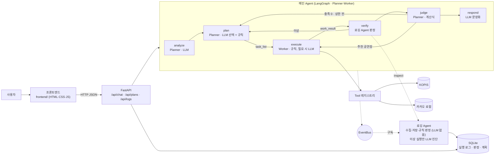

# 🎭 Stage Planner — Agent 기반 공연 관람 플래너

> SSAFY AI 코어 프로젝트 3회차 · **하네스 엔지니어링 + 에이전틱 엔지니어링** 실습 프로젝트

"이번 토요일 2시 이후 대학로에서 5만원 이하 연극 보고 6시 전에 끝내고 싶어. 끝나고 갈 식당도" 처럼 말하면,
**실제 공연 중인 작품**의 회차·러닝타임·가격을 조회해 조건을 계산으로 판단하고, 맞는 공연과 공연장 주변 식당을 추천합니다.
조건에 맞는 공연이 없으면 스스로 계획을 다시 세우고(최대 3회), 추천은 관람 계획으로 저장·관리할 수 있습니다.

LLM 만으로 답하면 이번 주 실제 공연·회차·가격을 **지어냅니다.** 이 서비스는 외부 API 로 확인한 값만 쓰고,
확인할 수 없는 값은 지어내지 않고 "늦어도 몇 시에 시작하는 회차여야 하는지"처럼 역산한 기준을 제시합니다.

---

## 목차
1. [주요 기능](#1-주요-기능) · 2. [구조](#2-구조) · 3. [실행 방법](#3-실행-방법) · 4. [API 키 발급](#4-api-키-발급과-설정) ·
5. [외부 API 출처와 이용 조건](#5-외부-api-출처와-이용-조건) · 6. [API 요약](#6-api-요약) · 7. [하네스·에이전틱 엔지니어링](#7-하네스에이전틱-엔지니어링) ·
8. [검증 결과](#8-검증-결과) · 9. [문서](#9-문서) · 10. [디렉터리](#10-디렉터리)

---

## 1. 주요 기능

### 필수 기능 (F3001 ~ F3019) — ✅ 구현·검증 완료
| 영역 | 기능 |
|---|---|
| **Tool** (F3001~F3004) | 외부 API 툴 3종 — `search_performances`(KOPIS 공연 목록), `get_performance_detail`(KOPIS 러닝타임·요일별 회차·가격·연령), `search_nearby_places`(KOPIS 공연장 좌표 → 카카오 로컬 주변 식당·카페·주차장). 모든 Tool 은 예외 대신 `{ok, data \| error{code,message}}` 공통 형식 |
| **메인 Agent** (F3005~F3011) | LangGraph `분석 → 계획 → 실행 → 판단 → 응답`. 조건 추출(기준·선호·제약), LLM 의 Tool 선택 + 규칙 검증, `종료 = 시작 + 러닝타임` 판단식, 규칙 기반 재계획(후보 확장 → 장르 해제 → 지역 확대, 상한 3), 대화 맥락(바뀐 조건만 갱신), 추천 근거·제외 사유 |
| **로깅** (F3012~F3014) | 메인 Agent 가 단계·Tool 호출·LLM 판단(이유 포함)을 이벤트로 발행 → **LLM 을 쓰지 않는** 로깅 서브 Agent 가 세션 단위로 그대로 저장. 조회·삭제만 가능(수정 불가) |
| **계획** (F3015~F3016) | 관람 계획 저장·조회·수정·삭제. 같은 날 시간이 겹치면 저장은 하되 알림 |
| **서버·화면** (F3017~F3019) | FastAPI (대화·계획·로그 경로 분리), 바닐라 JS 화면 3개(대화·계획 관리·실행 로그), 실행 과정 타임라인(재계획 지점 구분), 처리 중 표시, Tool 실패·키 누락 안내 |

### 심화 기능 — ✅ 구현·검증 완료
| 번호 | 기능 | 핵심 |
|---|---|---|
| **F3020** | 로깅 Agent 이상 징후 판단 | 실행마다 **규칙**으로 반복 호출·과도한 재계획·계획 외 호출을 판정(근거 없으면 '판정 불가'). **이상으로 판정된 실행에만** LLM 이 3문장 이내로 원인 진단, 판정과 분리 저장. 실행 중간에도 `inspect` 로 메인 Agent 에 판정 제공 |
| **F3021** | Planner · Worker 구조 | Planner(분석·계획·판단·재계획) ↔ Worker(작업 수행) ↔ 로깅 Agent(검증)가 정해진 형식으로 메시지를 주고받고 모두 실행 로그에 남음. Worker 는 **고칠 수 있는 실패에서만** LLM 으로 재시도·건너뜀·계획 변경 요청을 판단(검색어·반경만, 고정 인자 불가, 작업당 2회). 검증 이상 → Planner 가 작업 목록 재구성 |

**구조 변경 전후 비교** (실제 LLM·API, 시나리오 5 × 구성 3 — [`docs/verification/pw_comparison.md`](docs/verification/pw_comparison.md))
| 구성 | 요청당 LLM | 그중 Worker | 재계획 합계 | 평균 응답 | 차이 |
|---|---|---|---|---|---|
| baseline | 3.0 | 0.0 | 7 | 9.9초 | — |
| Planner·Worker · Worker LLM ON | 3.2 | 0.2 | **6** | 9.7초 | 공연명 오타를 Worker 가 고쳐 **답을 찾음**(C4), 후보 0건 시 의미 없는 재계획 생략(C5) |
| Planner·Worker · Worker LLM OFF | 3.0 | 0.0 | **6** | 8.9초 | C5 개선은 유지(규칙), C4 는 실패 |

구조 선택: `.env` 의 `AGENT_MODE=planner_worker`(기본) | `baseline`, `WORKER_LLM=on|off`, `LOG_DIAGNOSIS=on|off`.

## 2. 구조



- **LLM 은 판단이 필요한 세 곳만**: 조건 추출·의도 분류, Tool 선택, 응답 문장화. 계산·판정·재계획·저장은 코드가 한다. (요청당 LLM 3회, 되묻기 1회)
- 자세한 설계: [`docs/04_agent_design.md`](docs/04_agent_design.md)

## 3. 실행 방법

**요구 사항**: Python 3.10+ (개발·검증은 3.13.7), Node.js 18+ (프론트 단위 테스트에만 필요), 브라우저

```bash
# 1) 가상환경 + 의존성 (명세 고정 버전)
python -m venv .venv
.venv/Scripts/python -m pip install -r requirements-dev.txt     # macOS/Linux: .venv/bin/python

# 2) 키 설정 — 아래 4절 참고
cp .env.example .env       # .env 에 키 입력 (.env 는 git 에 올라가지 않음)

# 3) 백엔드 (API 문서: http://127.0.0.1:8000/docs)
.venv/Scripts/python -m uvicorn app.main:app --app-dir backend --port 8000

# 4) 프론트엔드 (다른 터미널) → http://127.0.0.1:5500
cd frontend && ../.venv/Scripts/python -m http.server 5500
```
- 프론트는 빌드 없이 ES 모듈로 동작합니다. API 주소는 기본 `http://127.0.0.1:8000`, 바꾸려면 브라우저 콘솔에서 `localStorage.apiBase = "http://..."`.
- 계획·실행 로그는 `data/planner.db`(SQLite)에 저장됩니다.

**테스트**
```bash
.venv/Scripts/python -m pytest              # 오프라인·결정적 188개 (외부 호출 없음)
.venv/Scripts/python -m pytest -m live      # 실제 API·LLM (비용 발생)
.venv/Scripts/python scripts/verification/run_scenarios.py   # 대표 시나리오 9종 실제 실행·기록
```

## 4. API 키 발급과 설정

`.env` 에 아래 값을 넣습니다. 키는 코드·문서·화면 어디에도 노출하지 않습니다(NF3001·NF3002). 화면에는 "설정됨/누락" 여부만 표시됩니다.

| 변수 | 발급 | 비고 |
|---|---|---|
| `LLM_API_KEY` | **OpenAI**: [platform.openai.com](https://platform.openai.com) → Billing 에서 크레딧 충전 → API keys → Create new secret key | 개인 키는 `LLM_BASE_URL` 을 비워 둠 |
| 〃 (대안) | **SSAFY GMS**: gms.ssafy.io 에서 키 확인 | `LLM_BASE_URL=https://gms.ssafy.io/gmsapi/api.openai.com/v1` |
| `LLM_MODEL` | — | 기본 `gpt-4.1-mini` |
| `KOPIS_API_KEY` | [kopis.or.kr](https://www.kopis.or.kr) 회원가입 → Open API → 서비스 키 신청 | |
| `KAKAO_REST_API_KEY` | [developers.kakao.com](https://developers.kakao.com) → 내 애플리케이션 → 앱 추가 → 앱 키의 **REST API 키** → 카카오맵(로컬) 사용 설정 | |

키가 없으면 서비스는 멈추지 않고 어떤 키가 필요한지 안내합니다 (`/api/health`, 대화 응답 `config_missing`).

## 5. 외부 API 출처와 이용 조건

| API | 제공 | 쓰는 정보 | 이용 조건 / 호출 한도 | 구현상 지키는 것 |
|---|---|---|---|---|
| KOPIS 공연예술통합전산망 Open API (공연목록·공연상세·공연시설상세) | 예술경영지원센터 | 공연 ID·제목·기간·장르, 러닝타임·회차·가격·관람연령, 공연장 주소·좌표 | 서비스 키 필요. **약관·일일 호출 한도는 공개 페이지에서 확인하지 못해 확인 중** (KOPIS 마이페이지 안내 기준으로 갱신 예정) | 자체 식별 User-Agent `ai-planner/0.1 (SSAFY AI core project)` 사용(브라우저 위장 금지), 연결 재사용, 실패 시 최대 3회 백오프, 단계당 상세 조회 15건 상한, 출처 표기 |
| 카카오 로컬 API (카테고리로 장소 검색) | 카카오 | 공연장 주변 식당·카페·주차장 이름·주소·거리·링크 | 카카오 개발자 이용약관. 키워드·카테고리 장소 검색 **각 일 100,000건**, 전체 월 3,000,000건 ([쿼터](https://developers.kakao.com/docs/latest/ko/getting-started/quota)) | 추천 공연장(최대 3곳)에만 호출, 장소와 공연을 임의로 연결하지 않음 |
| OpenAI API (또는 SSAFY GMS) | OpenAI | 조건 추출, Tool 선택, 응답 문장 | 사용량 과금, OpenAI 이용 정책 | 요청당 3회 이내, 응답은 코드가 만든 결과만 문장화 |

> 공연 정보 출처: (재)예술경영지원센터 공연예술통합전산망(KOPIS). 장소 정보 출처: 카카오.
> 추천은 공연 일정 정보를 바탕으로 한 것이며, 실제 예매 가능 여부와 잔여석은 확인하지 않습니다.

## 6. API 요약
| 경로 | 메서드 | 설명 |
|---|---|---|
| `/api/chat` | POST | 대화 → 메인 Agent 실행. 추천·근거·제외 사유·실행 타임라인 반환 |
| `/api/chat/sessions/{id}` | DELETE | 대화 맥락 초기화 |
| `/api/plans` | GET · POST | 계획 목록(날짜 필터) · 저장(겹침 알림) |
| `/api/plans/{id}` | GET · PATCH · DELETE | 상세 · 수정(겹침 재검사) · 삭제 |
| `/api/logs` | GET | 세션 단위 실행 로그 목록 |
| `/api/logs/{session_id}` | GET · DELETE | 실행 순서대로 상세 · 삭제 (**수정 없음** → 405) |
| `/api/health` · `/api/tools` | GET | 키 설정 여부(값 없음) · 등록 Tool 명세 |

전체 형식: [`docs/05_api_spec.md`](docs/05_api_spec.md), 실행 중 `/docs`.

## 7. 하네스·에이전틱 엔지니어링

이 프로젝트는 서비스와 개발 과정 **둘 다** 에이전트를 "기준·규칙·검증·기록"으로 둘러싸 결과를 믿을 수 있게 만드는 연습입니다.

### 7.1 개발 하네스 (Claude Code 와 함께 개발하는 방식)
| 장치 | 위치 | 역할 |
|---|---|---|
| 기준 문서 | `docs/00~07` | 구현의 단일 기준. 구현이 달라지면 문서를 먼저 고친다 |
| 규칙 | `CLAUDE.md` | 불변 규칙(Tool 예외 금지, 로깅 LLM 금지, 키 노출 금지…), 테스트 우선, 커밋 규칙 |
| 기획 검증 | `scripts/validation/` | 구현 전에 실제 API 를 호출해 가정 확인 → User-Agent 차단·XML·charset·연결 끊김을 **코드 작성 전에** 발견 |
| 테스트 하네스 | `tests/` | 가짜 LLM(대본), 가짜 HTTP(녹화 응답·KOPIS 이상 동작 재현), 외부 네트워크 차단, 가드 테스트, API 계약 테스트 |
| 게이트 hook | `.claude/settings.json` → `scripts/hooks/harness_gate.py` | `git commit`/`push` 직전 전체 테스트, 실패 시 차단. 응답 종료 시 마지막 통과 이후 코드가 바뀐 경우에만 테스트 |
| 결함 주입 | 각 단계 | 핵심 규칙을 일부러 깨서 테스트가 잡는지 확인 — 24종 중 2종을 처음에 놓쳐 테스트 보강 |
| 실측 시나리오 | `scripts/verification/` | 실제 LLM·API 로 대표 요청 실행 → 자동 검사가 놓친 3건을 사람이 발견해 수정 |

개발 루프: **명세 → 테스트 작성 → 실패 확인(Red) → 구현 → 통과(Green) → 결함 주입 → 커밋(hook 게이트) → push**

### 7.2 제품 하네스 (서비스 안의 Agent)
- 규칙으로 되는 일은 코드가 — 계산·판정·재계획은 LLM 없이, LLM 출력(Tool 선택)은 규칙으로 검증·보정
- Tool 인자는 LLM 이 아니라 추출된 조건으로 채움 (값을 지어내지 못하게)
- 실패는 형식으로 — 치명적 실패(키·인증·한도)는 즉시 안내, 다시 시도할 수 있는 실패만 재계획
- 모든 판단은 이벤트로 기록되고 수정할 수 없음 → 사후 관찰·진단 가능 (심화 F3020 의 근거)

## 8. 검증 결과
- 자동 테스트 **221 통과** (Tool 87 · Agent 71 · 저장소 15 · API 14 · 하네스 10 · 이벤트 10 · 가드 7 · 프론트 7 + JS 단위 14)
- 대표 시나리오 9종 (한 번에 충족, **재계획**, **상한 도달**, **Tool 실패**, **Tool 불필요**, 되묻기, 맥락 유지, 저장, 키 누락) 최종 Planner·Worker 구조에서 실제 실행 → 모두 기대와 일치
- 심화: F3020·F3021 확인 항목 전부 + 구조 전후 비교
- 실측에서 찾아 고친 문제 7건 (지난 회차 추천, 실패 안내 오류, 되묻기 문장, 공연명 질문이 오늘만 검색, Worker 검색어 덧붙임, 시나리오 전제 오류, 이벤트 참조 공유)
- 대표 계획 요청 처리 시간 약 10~17초 (KOPIS ~5초, 카카오 ~3초, LLM 3회 ~8초)
- 상세: [`docs/07_verification.md`](docs/07_verification.md), 시나리오 기록 [`docs/verification/scenario_report.md`](docs/verification/scenario_report.md)

## 9. 문서
| 제출물 | 문서 |
|---|---|
| 요구사항 정의서 (도메인 근거·요구사항 표·기획 검증) | [`docs/01_requirements.md`](docs/01_requirements.md), [`docs/03_planning_validation.md`](docs/03_planning_validation.md) |
| Agent 설계 문서 | [`docs/04_agent_design.md`](docs/04_agent_design.md) |
| Tool 정의서 | [`docs/02_tool_spec.md`](docs/02_tool_spec.md) |
| API 명세서 | [`docs/05_api_spec.md`](docs/05_api_spec.md) |
| 검증 결과 | [`docs/07_verification.md`](docs/07_verification.md), [`docs/verification/`](docs/verification/) |
| 실행 로그 샘플 | [`docs/verification/logs/V1.json`](docs/verification/logs/V1.json) (대표 요청 전체), `V2.json`·`V3.json` (재계획) |
| 진행 계획·결정 로그 · 테스트 전략 | [`docs/00_project_plan.md`](docs/00_project_plan.md), [`docs/06_test_strategy.md`](docs/06_test_strategy.md) |

## 10. 디렉터리
```
backend/app/
  agents/      graph.py(LangGraph) · nodes/{analyze,plan,execute,judge,respond}.py · judge.py(판단식) · memory.py
               logging_agent.py(LLM 없음) · runtime.py(이벤트 발행·Tool 호출) · prompts.py
  tools/       base.py(공통 응답) · registry.py · kopis.py · kakao.py · parsers.py · codes.py · factory.py
  events/      bus.py
  storage/     db.py · plans.py · logs.py (SQLite)
  api/         app.py · routes.py      schemas/api.py      core/{config,llm}.py      main.py
frontend/      index.html(대화) · plans.html · logs.html · js/{api,dom,format,timeline,chat,plans,logs}.js · tests/*.test.mjs
tests/         tools/ agents/ storage/ events/ api/ frontend/ guards/ harness/ fakes/ fixtures/
scripts/       validation/(기획 검증) · verification/(시나리오) · hooks/(게이트)
docs/          00~07 문서 · verification/(증거)
```
